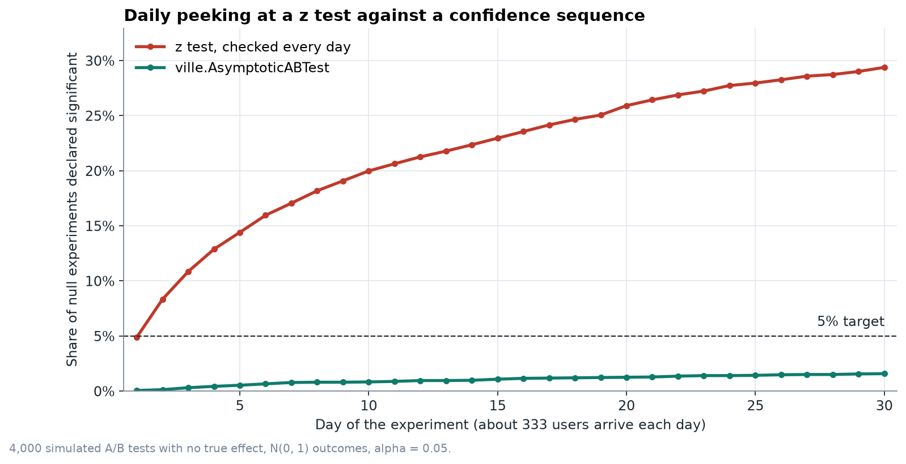
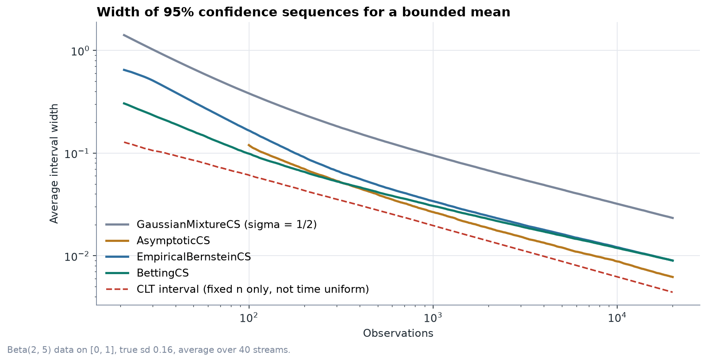
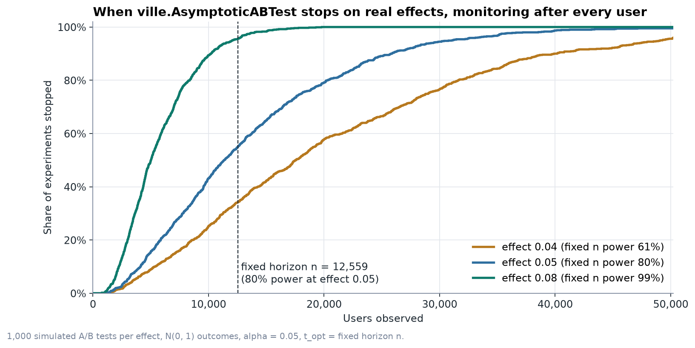

# ville

Confidence sequences, sequential tests and e-values for anytime valid inference in Python.

Classical confidence intervals and p-values assume a sample size fixed in advance and a single analysis. Under repeated analysis of accumulating data (continuous monitoring, interim looks, optional stopping) the type I error rate exceeds the nominal level. The methods implemented here control error rates uniformly over time: the coverage and type I error guarantees hold simultaneously for all sample sizes, so the data may be monitored continuously and the experiment stopped or extended at any point.

The package is named after Jean Ville, whose maximal inequality for nonnegative supermartingales (Ville 1939) underlies all of the methods.



*Figure 1. Cumulative false positive rate over 4,000 simulated A/B tests with no true effect, analysed once per day for 30 days. Two sample z test at α = 0.05: 29.4% by day 30. `ville.AsymptoticABTest` at the same looks: 1.6%. Script: [`benchmarks/peeking.py`](https://github.com/shivsbhaduri/ville/blob/main/benchmarks/peeking.py).*

## Contents

1. [Installation](#installation)
2. [Quick start](#quick-start)
3. [What is in the library](#what-is-in-the-library)
4. [The mathematics](#the-mathematics)
5. [Worked examples](#worked-examples)
6. [Benchmarks](#benchmarks)
7. [Choosing a method](#choosing-a-method)
8. [Assumptions and limitations](#assumptions-and-limitations)
9. [Reproducing the results](#reproducing-the-results)
10. [Related software](#related-software)
11. [References](#references)

## Installation

```bash
pip install ville
```

To work on the code, install from a clone instead:

```bash
git clone https://github.com/shivsbhaduri/ville.git
cd ville
pip install -e ".[test,examples]"
```

It needs Python 3.10 or later, NumPy and SciPy. Matplotlib is only needed to redraw the figures.

## Quick start

All confidence sequences share one interface. `fit(x)` processes a stream from the start, `update(x)` appends observations, and `estimate_`, `lower_` and `upper_` hold one value per observation.

```python
import numpy as np
import ville

rng = np.random.default_rng(42)
n = 40_000
treated = (rng.random(n) < 0.5).astype(float)
converted = (rng.random(n) < np.where(treated == 1, 0.050, 0.040)).astype(float)

control = ville.BernoulliCS(alpha=0.05).fit(converted[treated == 0])
test = ville.BettingABTest(bounds=(0, 1), alpha=0.05).fit(converted, treated)

for t in (5000, 10_000, 20_000, n):
    print(t, test.estimate_[t - 1], test.lower_[t - 1], test.upper_[t - 1])
print(test.stopping_time())
```

Output from [`examples/conversion_rate.py`](https://github.com/shivsbhaduri/ville/blob/main/examples/conversion_rate.py):

```text
Control conversion rate
  after    500 users: 0.0480  [0.0214, 0.0699]
  after  2,000 users: 0.0410  [0.0277, 0.0605]
  after 10,000 users: 0.0408  [0.0335, 0.0492]
  after 20,147 users: 0.0399  [0.0348, 0.0459]

Difference in conversion rate, treatment minus control
  after  5,000 users: +0.0126  [-0.0073, +0.0331]
  after 10,000 users: +0.0118  [-0.0025, +0.0271]
  after 20,000 users: +0.0101  [-0.0001, +0.0223]
  after 40,000 users: +0.0098  [+0.0019, +0.0189]

Zero first excluded after 20,579 users (betting)
Zero first excluded after 16,532 users (asymptotic)
```

The intervals hold simultaneously over all $t$, so they may be inspected at any time, and the decision to continue may depend on what was observed. The true difference is 0.010.

Observations may also be supplied in batches:

```python
cs = ville.EmpiricalBernsteinCS(bounds=(0, 1))
for batch in daily_batches:
    cs.update(batch)
    lo, hi = cs.interval()
```

## What is in the library

| Class | Target | Assumptions | Method |
|---|---|---|---|
| `GaussianMixtureCS` | mean | sub-Gaussian with known scale | Robbins (1970); Howard et al. (2021) |
| `AsymptoticCS` | mean | finite variance, large sample | Waudby-Smith et al. (2024) |
| `EmpiricalBernsteinCS` | mean | known bounds | Waudby-Smith and Ramdas (2024), Theorem 2 |
| `BettingCS` | mean | known bounds | Waudby-Smith and Ramdas (2024), Theorem 3 |
| `BernoulliCS` | proportion | binary data | beta-binomial mixture; Howard et al. (2021) |
| `QuantileCS` | any quantile | none beyond i.i.d. | Howard and Ramdas (2022) |
| `VarianceCS` | variance | known bounds | paired differences with `BettingCS` |
| `AsymptoticABTest` | average treatment effect | randomised, finite variance | Waudby-Smith et al. (2024) |
| `BettingABTest` | average treatment effect | randomised, bounded outcome | Waudby-Smith and Ramdas (2024) |
| `MSPRT` | Gaussian mean test | Gaussian or sub-Gaussian | Johari et al. (2022) |
| `BettingTest` | bounded mean test | known bounds | Waudby-Smith and Ramdas (2024) |
| `BernoulliTest` | proportion test | binary data | beta-binomial Bayes factor |
| `evalues.p_to_e`, `e_to_p`, `combine` | e-value calculus | see below | Vovk and Wang (2021) |
| `evalues.ebh` | false discovery rate | arbitrary dependence | Wang and Ramdas (2022) |
| `simulate.peeking`, `simulate.stopping_times` | diagnostics | | |

Confidence sequences inherit from `ville.ConfidenceSequence` and sequential tests from `ville.SequentialTest`. Tests expose `e_values_`, anytime valid `p_values_` and `stopping_time(alpha)`.

## The mathematics

Notation: $X_1, X_2, \dots$ for the stream, $S_t = \sum_{i \le t} (X_i - \mu)$ for the centred running sum and $\bar X_t$ for the running mean.

### Test martingales and Ville's inequality

A **test martingale** for a null hypothesis $H_0$ is a process $M_0 = 1, M_1, M_2, \dots$ that is nonnegative and, under $H_0$, a supermartingale: $\mathbb{E}[M_t \mid X_1, \dots, X_{t-1}] \le M_{t-1}$. Equivalently, $M_t$ is the wealth of a gambler who starts with one unit and bets against $H_0$ at fair odds.

**Ville's inequality** (Ville 1939):

```math
\Pr_{H_0}\left( \exists\, t \ge 1 : M_t \ge \frac{1}{\alpha} \right) \le \alpha .
```

Proof: let $\tau$ be the first $t$ with $M_t \ge 1/\alpha$. By optional stopping $\mathbb{E}[M_{\tau \wedge t}] \le 1$, hence $\Pr(\tau \le t) / \alpha \le 1$ for every $t$; let $t \to \infty$.

The inequality is a time uniform form of Markov's inequality. It implies that the test rejecting $H_0$ at the first $t$ with $M_t \ge 1/\alpha$ has level $\alpha$ under any stopping rule. Shafer et al. (2011) and Ramdas et al. (2023) survey the area.

### E-values, e-processes and anytime valid p-values

An **e-value** is a nonnegative statistic $E$ with $\mathbb{E}_{H_0}[E] \le 1$. Large values are evidence against $H_0$, and $\Pr(E \ge 1/\alpha) \le \alpha$ by Markov's inequality. An **e-process** is a sequence $E_t$ such that $E_\tau$ is an e-value for every stopping time $\tau$. Test martingales are e-processes.

From an e-process `ville` reports the **anytime valid p-value**

```math
p_t = \min\left(1, \frac{1}{\max_{s \le t} E_s}\right),
```

which is nonincreasing and satisfies $\Pr_{H_0}(\exists\, t : p_t \le \alpha) \le \alpha$.

### Confidence sequences

A **confidence sequence** is a sequence of sets $C_1, C_2, \dots$ with

```math
\Pr\left( \forall\, t \ge 1 : \theta \in C_t \right) \ge 1 - \alpha .
```

Confidence sequences were introduced by Darling and Robbins (1967). A confidence interval satisfies only $\Pr(\theta \in C_n) \ge 1 - \alpha$ for a fixed $n$. Confidence sequences are obtained by inverting a family of e-processes indexed by the parameter:

```math
C_t = \{\, \theta_0 : E_t(\theta_0) < 1/\alpha \,\}.
```

By Ville's inequality the probability that the true $\theta$ is ever excluded is at most $\alpha$. The running intersection $\bigcap_{s \le t} C_s$ is therefore also a confidence sequence; `ville` returns it by default (`intersect=True`).

Time uniform coverage increases width. By the law of the iterated logarithm no confidence sequence can shrink faster than order $\sqrt{\log\log t / t}$, against $\sqrt{1/t}$ for a fixed $n$ interval. In the [benchmarks](#benchmarks) the variance adaptive sequences are 1.4 to 2 times the width of the fixed $n$ CLT interval.

### Normal mixtures: `GaussianMixtureCS` and `MSPRT`

Suppose the observations are $\sigma$ sub-Gaussian, meaning $\mathbb{E}[e^{\lambda (X - \mu)}] \le e^{\lambda^2 \sigma^2 / 2}$ for all $\lambda$. Then for each fixed $\lambda$

```math
M_t(\lambda) = \exp\left( \lambda S_t - \tfrac{1}{2} \lambda^2 \sigma^2 t \right)
```

is a test martingale for the true mean. A single $\lambda$ has power against one effect size only. Robbins (1970) mixes over $\lambda \sim N(0, 1/\rho)$, which gives the closed form

```math
M_t = \int M_t(\lambda)\, dF(\lambda) = \sqrt{\frac{\rho}{\sigma^2 t + \rho}}\; \exp\left( \frac{S_t^2}{2(\sigma^2 t + \rho)} \right).
```

Setting $M_t = 1/\alpha$ and solving for $S_t$ gives the confidence sequence

```math
\bar X_t \pm \frac{1}{t} \sqrt{ (\sigma^2 t + \rho) \log\left( \frac{\sigma^2 t + \rho}{\rho\, \alpha^2} \right) } .
```

The width is of order $\sqrt{\log t / t}$. The mixing precision $\rho$ determines the sample size at which the boundary is tightest. Minimising the boundary at $t^\star$ gives $r - \log r = 1 + 2\log(1/\alpha)$ with $r = (\sigma^2 t^\star + \rho)/\rho$; `ville` solves this numerically for the `t_opt` argument. The choice of $\rho$ affects width only.

By Hoeffding's lemma, data on $[a, b]$ are $(b - a)/2$ sub-Gaussian, so the sequence applies to bounded data. It does not adapt to the variance and is the widest method in the package when the variance is small.

`MSPRT` is the corresponding test. Johari et al. (2022) place a $N(\theta_0, \tau^2)$ prior on the alternative mean, which is the mixture above with $\rho = \sigma^4 / \tau^2$:

```math
\Lambda_t = \sqrt{\frac{\sigma^2}{\sigma^2 + t \tau^2}}\; \exp\left( \frac{t^2 \tau^2 (\bar X_t - \theta_0)^2}{2 \sigma^2 (\sigma^2 + t \tau^2)} \right).
```

If `tau` is not given it is set from `t_opt` as above.

### Asymptotic confidence sequences: `AsymptoticCS`

When there are no known bounds and no known scale, Waudby-Smith et al. (2024) show that the normal mixture boundary with $\sigma$ replaced by the sample standard deviation $\hat\sigma_t$ gives an **asymptotic confidence sequence**:

```math
\bar X_t \pm \hat\sigma_t \sqrt{ \frac{2 (t \rho^2 + 1)}{t^2 \rho^2} \log\left( \frac{\sqrt{t \rho^2 + 1}}{\alpha} \right) } .
```

$\rho$ is set from `t_opt` as above. The sequence is the time uniform analogue of the CLT interval $\bar X_t \pm z_{1-\alpha/2}\, \hat\sigma_t / \sqrt t$ and requires finite moments of order slightly above two. The guarantee is asymptotic: in the definition of Waudby-Smith et al. the sequence is coupled to a nonasymptotic one with width ratio tending to one, and coverage from time $m$ onwards tends to at least $1 - \alpha$ as $m \to \infty$. `ville` therefore returns an infinite interval until `min_samples` observations (default 100) are available. The coverage tests check this default on exponential data.

### Betting confidence sequences: `BettingCS` and `BettingTest`

For data in $[0, 1]$ (other known ranges are rescaled) and a candidate mean $m$, define the capital process

```math
K_t(m) = \prod_{i=1}^{t} \bigl( 1 + \lambda_i (X_i - m) \bigr).
```

If $\lambda_i$ is predictable (a function of $X_1, \dots, X_{i-1}$) and lies in $[-1/(1-m),\, 1/m]$, then $K_t(m) \ge 0$ and, when the mean is $m$, $K_t(m)$ is a martingale. This holds for every distribution on $[0, 1]$ with mean $m$. No parametric model is required, and the predictable $\lambda_i$ adapt to the variance.

Waudby-Smith and Ramdas (2024, Theorem 3) use the hedged process

```math
K_t^{\pm}(m) = \max\Bigl\{ \theta \prod_{i \le t} \bigl(1 + \lambda_i^{+}(m)(X_i - m)\bigr),\;
(1 - \theta) \prod_{i \le t} \bigl(1 - \lambda_i^{-}(m)(X_i - m)\bigr) \Bigr\},
```

and $C_t = \{ m : K_t^{\pm}(m) < 1/\alpha \}$, which is an interval. The bets follow their predictable plug-in rule

```math
\lambda_i^{+}(m) = \min\left( \dot\lambda_i,\, \frac{c}{m} \right), \quad
\lambda_i^{-}(m) = \min\left( \dot\lambda_i,\, \frac{c}{1 - m} \right), \quad
\dot\lambda_i = \sqrt{ \frac{2 \log(2/\alpha)}{\hat\sigma_{i-1}^2\, i \log(1 + i)} },
```

with $c = 1/2$ by default and the regularised running estimates

```math
\hat\mu_t = \frac{1/2 + \sum_{i \le t} X_i}{t + 1}, \qquad
\hat\sigma_t^2 = \frac{1/4 + \sum_{i \le t} (X_i - \hat\mu_i)^2}{t + 1}.
```

`ville` evaluates $K_t^{\pm}$ on a grid of candidate means (`grid=10_000` by default) and widens the reported interval to the adjacent grid points, so the discretisation is conservative. Under the running intersection, excluded candidates cannot re-enter, so only grid points inside the current interval are updated and the cost per observation decreases as the interval shrinks.

`BettingTest` evaluates the capital process at a single null value $m_0$. The two sided e-process is $\theta K^{+} + (1-\theta) K^{-}$, a martingale under $H_0$. The one sided tests use $K^{+}$ or $K^{-}$ alone and are also valid for the composite nulls $\mu \le m_0$ and $\mu \ge m_0$.

### Empirical Bernstein: `EmpiricalBernsteinCS`

A closed form sequence from the same paper (Waudby-Smith and Ramdas 2024, Theorem 2). With $\lambda_i = \min(\dot\lambda_i, c)$, $v_i = 4 (X_i - \hat\mu_{i-1})^2$ and $\psi_E(\lambda) = (-\log(1 - \lambda) - \lambda)/4$,

```math
C_t = \left( \frac{\sum_{i \le t} \lambda_i X_i}{\sum_{i \le t} \lambda_i} \;\pm\; \frac{\log(2/\alpha) + \sum_{i \le t} v_i\, \psi_E(\lambda_i)}{\sum_{i \le t} \lambda_i} \right) \cap [0, 1].
```

It adapts to the variance and costs $O(1)$ per observation.

### Proportions: `BernoulliCS` and `BernoulliTest`

For binary data with $S_t$ successes in $t$ trials, the Bayes factor of a $\text{Beta}(a, b)$ mixture against the point null $p = p_0$ is

```math
E_t(p_0) = \frac{B(a + S_t,\, b + t - S_t) / B(a, b)}{p_0^{S_t} (1 - p_0)^{t - S_t}} .
```

The numerator is the marginal likelihood under the mixture and the denominator the likelihood under $H_0$, so $E_t$ is a likelihood ratio with $\mathbb{E}_{H_0}[E_t] = 1$ for all $t$, and hence a test martingale. The test suite verifies the unit mean by exact summation over the binomial distribution. Monte Carlo is unsuitable here because the mean is dominated by sequences of probability around $2^{-200}$.

`BernoulliCS` inverts this family. Since $-\log E_t(p_0)$ is concave in $p_0$ with maximum at $\hat p = S_t / t$, the set $\{ p_0 : E_t(p_0) < 1/\alpha \}$ is an interval; its end points are computed by bisection. The prior affects width only.

### Quantiles: `QuantileCS`

Howard and Ramdas (2022) construct quantile confidence sequences from a counting argument. Let $Q$ be the true $q$ quantile. The number of observations at or below $Q$ is a sum of Bernoulli variables with success probability at least $q$, and the number strictly below $Q$ a sum with probability at most $q$. A time uniform boundary $u_t$ for a centred sum of Bernoulli($q$) variables therefore gives, with probability at least $1 - \alpha$ for all $t$ at once,

```math
X_{(\lceil t q - u_t \rceil)} \;\le\; Q \;\le\; X_{(\lfloor t q + u_t \rfloor + 1)} ,
```

where $X_{(k)}$ is the $k$-th order statistic of the first $t$ observations, and the bound is infinite when the index falls outside $1, \dots, t$. No distributional assumption is needed beyond i.i.d. sampling. Ties and atoms are permitted; the tests include a distribution with half its mass at the median.

`ville` uses for $u_t$ the one sided normal mixture boundary at level $\alpha/2$ per side, with variance proxy $1/4$ (Hoeffding). The half normal mixture over $\lambda \ge 0$ gives

```math
M_t = 2 \sqrt{\frac{\rho}{v + \rho}}\; \exp\left( \frac{s^2}{2(v + \rho)} \right) \Phi\left( \frac{s}{\sqrt{v + \rho}} \right), \qquad v = t/4,
```

and $u_t$ solves $M_t = 2/\alpha$, computed by bisection.

### Variances: `VarianceCS`

For i.i.d. data on $[a, b]$, consecutive pairs give $Y_k = (X_{2k} - X_{2k-1})^2 / 2$, which has mean $\sigma^2$ and lies in $[0, (b - a)^2 / 2]$. A betting confidence sequence for the mean of the $Y_k$ is therefore a confidence sequence for $\sigma^2$. It is capped at $(b - a)^2/4$, the maximum variance on $[a, b]$. The construction is exactly valid but uses half the information of a full U-statistic, so it is conservative.

### A/B tests: `AsymptoticABTest` and `BettingABTest`

In a randomised experiment unit $i$ is treated ($A_i = 1$) with known probability $\pi$. For any centre $m_{i-1}$ computed from earlier units only, the pseudo outcome

```math
\phi_i = (Y_i - m_{i-1}) \left( \frac{A_i}{\pi} - \frac{1 - A_i}{1 - \pi} \right)
```

has conditional mean $\mathbb{E}[Y(1)] - \mathbb{E}[Y(0)]$, the average treatment effect, because the centre contributes $m_{i-1} - m_{i-1} = 0$. A confidence sequence for the mean of the $\phi_i$ is therefore a confidence sequence for the effect. `ville` uses the running mean of past outcomes as the centre. Without centring, the inverse propensity weights carry the baseline level of the outcome into the variance of $\phi_i$, which is large for metrics such as revenue whose mean is far from zero.

`AsymptoticABTest` applies `AsymptoticCS` to the $\phi_i$, following the randomised experiment setting of Waudby-Smith et al. (2024). `BettingABTest` applies `BettingCS`, using the bound $|\phi_i| \le (b - a) / \min(\pi, 1 - \pi)$ for outcomes in $[a, b]$. It is nonasymptotic.

### Working with e-values: `ville.evalues`

**Calibration.** Any p-value can be turned into an e-value with a calibrator (Vovk and Wang 2021). For $\kappa \in (0, 1)$, $\kappa p^{\kappa - 1}$ is one. Integrating over $\kappa$ gives

```math
\int_0^1 \kappa p^{\kappa - 1}\, d\kappa = \frac{1 - p + p \log p}{p (\log p)^2},
```

which is what `p_to_e(p)` returns. In the other direction `e_to_p(e)` returns $\min(1, 1/e)$.

**Combination.** The average of e-values for the same null is an e-value under any dependence. The product is an e-value when they are independent, or when each is valid conditionally on its predecessors, as with e-values from successive experiments.

**Multiple testing.** For $m$ hypotheses with e-values $e_1, \dots, e_m$, e-BH (Wang and Ramdas 2022) rejects the $\hat k$ hypotheses with the largest e-values, where

```math
\hat k = \max\left\{ k : \frac{k\, e_{[k]}}{m} \ge \frac{1}{\alpha} \right\}
```

and $e_{[k]}$ is the $k$-th largest. It controls the false discovery rate at $\alpha$ under arbitrary dependence between the e-values, as arises when several metrics are computed from one experiment.

## Worked examples

All examples are in [`examples/`](https://github.com/shivsbhaduri/ville/tree/main/examples/). Outputs below are unedited.

### Revenue per visitor: an unbounded, skewed metric

Revenue per visitor has a point mass at zero, a heavy right tail and no natural upper bound, so `AsymptoticABTest` is used.

```python
rng = np.random.default_rng(7)
n = 100_000
treated = (rng.random(n) < 0.5).astype(float)
buys = rng.random(n) < np.where(treated == 1, 0.10, 0.08)
basket = rng.lognormal(mean=3.5, sigma=0.9, size=n)
revenue = np.where(buys, basket, 0.0)

test = ville.AsymptoticABTest(alpha=0.05, t_opt=20_000).fit(revenue, treated)
stop = test.stopping_time()
```

```text
AsymptoticABTest(n=100000, effect=1.19477, interval=(0.75304, 1.6365))
Stopped after 7,040 visitors
Effect at stopping: +1.464 per visitor, 95% CS [+0.001, +2.928]
True effect: +0.993 per visitor
```

The test stops at 7,040 of 100,000 visitors. Point estimates at data dependent stopping times are biased upwards, since stopping tends to occur when the estimate is large. The confidence sequence at the stopping time contains the true effect and is the quantity to report.

### Sequential tests and anytime valid p-values

```python
x = rng.normal(0.15, 1.0, 5000)
msprt = ville.MSPRT(theta0=0.0, sigma=1.0, alpha=0.05, t_opt=1000).fit(x)

scores = rng.beta(6, 4, 3000)
bet = ville.BettingTest(m0=0.55, bounds=(0, 1), alternative="greater").fit(scores)
```

```text
MSPRT(n=5000, e=4.899e+24, p=1.399e-25)
  e-value first reached 20 at t = 274
  anytime valid p-value at t =  100: 9.20e-01
  anytime valid p-value at t =  200: 1.25e-01
  anytime valid p-value at t =  300: 1.80e-02
  anytime valid p-value at t = 1000: 2.51e-07
BettingTest(n=3000, e=7.58e+16, p=1.273e-17)
  rejected mean <= 0.55 at t = 59 (true mean 0.6)
Null runs ever rejected at alpha = 0.05: 0.032
```

The final line reports 500 betting tests under the null, each monitored at every observation up to $t = 2{,}000$: 3.2% reject at some point, against a nominal 5%.

### Latency percentiles

`QuantileCS` makes no distributional assumptions, which is appropriate for response times.

```python
latency_ms = rng.lognormal(mean=4.0, sigma=0.6, size=10_000)
p95 = ville.QuantileCS(q=0.95, alpha=0.05, t_opt=2000).fit(latency_ms)
```

```text
q = 0.5: true 54.6 ms
  after    200 requests:    55.1 ms  [   46.4,    68.9]
  after  1,000 requests:    56.4 ms  [   52.1,    61.0]
  after 10,000 requests:    55.5 ms  [   54.0,    56.8]
q = 0.95: true 146.5 ms
  after    200 requests:   135.5 ms  [   88.9,     inf]
  after  1,000 requests:   145.1 ms  [  119.2,   313.5]
  after 10,000 requests:   145.6 ms  [  134.1,   161.1]
Variance of U(0, 1), true 0.0833: estimate 0.0832, 95% CS [0.0780, 0.0869]
```

At $t = 200$ the upper bound for the 95th percentile is infinite: with about 10 observations above the quantile, the tail cannot be bounded without further assumptions.

### Twenty metrics, correlated, with e-BH

Twenty metrics from one experiment, four with nonzero effects. A per user shock common to all metrics makes the e-values dependent. e-BH is valid under arbitrary dependence without adjustment.

```python
test = ville.MSPRT(theta0=0.0, sigma=np.sqrt(2 * 1.25), t_opt=pairs).fit(y_t - y_c)
...
ville.evalues.ebh(e_values, alpha=0.1)
```

```text
metric  true effect     e-value
     0         0.10    4.86e+20
     1         0.08    3.42e+08
     2         0.06    1.77e+06
     3         0.04    3.48e+05
     4         0.00       0.331
     5         0.00       0.333
     6         0.00        0.33
   ...
Rejected by e-BH at 10%: [0, 1, 2, 3]
Rejected by BH on p = 1/e at 10%: [0, 1, 2, 3]
```

## Benchmarks

Each figure is produced by a script in [`benchmarks/`](https://github.com/shivsbhaduri/ville/tree/main/benchmarks/) with a fixed seed.

### False positives under peeking

Figure 1. Two sample z test at $\alpha = 0.05$, analysed once per day for 30 days, on experiments with no true effect.

| Day | Users | z test, ever significant | `AsymptoticABTest`, ever significant |
|---:|---:|---:|---:|
| 1 | 333 | 4.9% | 0.1% |
| 2 | 666 | 8.3% | 0.1% |
| 5 | 1,666 | 14.4% | 0.5% |
| 10 | 3,333 | 20.0% | 0.8% |
| 20 | 6,666 | 25.9% | 1.3% |
| 30 | 10,000 | 29.4% | 1.6% |

The confidence sequence controls the error rate at 5% under monitoring after every observation; with daily looks it is well below that.

### Width



Average width over 40 streams of Beta(2, 5) data (support $[0, 1]$, standard deviation 0.16).

| n | GaussianMixtureCS | AsymptoticCS | EmpiricalBernsteinCS | BettingCS | CLT interval (fixed n) |
|---:|---:|---:|---:|---:|---:|
| 100 | 0.382 | 0.120 | 0.166 | 0.099 | 0.061 |
| 1,000 | 0.095 | 0.027 | 0.034 | 0.031 | 0.020 |
| 10,000 | 0.032 | 0.009 | 0.012 | 0.012 | 0.006 |
| 20,000 | 0.023 | 0.006 | 0.009 | 0.009 | 0.004 |

Without variance information (`GaussianMixtureCS` with the Hoeffding scale) the sequence is 2.3 to 3.9 times the width of the variance adaptive ones. The betting and empirical Bernstein sequences are nonasymptotic; betting is narrower at small $n$. `AsymptoticCS` is the narrowest time uniform method at large $n$, with an asymptotic guarantee only. The CLT interval is not time uniform and is shown for reference.

### Time to a decision



A fixed horizon z test sized for 80% power at an effect of 0.05 needs 12,559 users. The confidence sequence is monitored after every user, with `t_opt` set to the same horizon.

| True effect | Stopped by 12,559 users | Median stopping time | Power of the fixed horizon test |
|---:|---:|---:|---:|
| 0.04 | 34.3% | 17,558 | 61.1% |
| 0.05 | 55.1% | 11,351 | 80.0% |
| 0.08 | 95.6% | 5,013 | 99.4% |

At its design sample size the fixed horizon test has higher power than a sequence that must be valid at all sample sizes (80.0% against 55.1% at effect 0.05). The sequence stops earlier on larger effects (median 5,013 users against 12,559 at effect 0.08) and allows the experiment to continue past the horizon when the effect is smaller than planned. The type I error rate is controlled in all cases.

## Choosing a method

| Your data | Use |
|---|---|
| Binary outcomes (conversion, click, churn) | `BernoulliCS`, `BernoulliTest`; `BettingABTest` for a difference |
| Bounded outcomes with a known range (scores, ratings, capped values) | `BettingCS`; `EmpiricalBernsteinCS` when speed matters |
| Unbounded or heavy tailed (revenue, time spent) | `AsymptoticCS`, `AsymptoticABTest` |
| Gaussian measurements with known noise level | `GaussianMixtureCS`, `MSPRT` |
| Medians, percentiles, latency | `QuantileCS` |
| Spread of a bounded metric | `VarianceCS` |
| Many hypotheses at once | e-values from any of the above, then `evalues.ebh` |

`t_opt` should be close to the sample size at which most decisions are expected. It affects width, not validity.

## Assumptions and limitations

* **Independence.** The confidence sequences assume i.i.d. observations, or for the A/B tests units that are independently randomised with a known probability. The betting and normal mixture constructions hold under weaker martingale conditions (a constant conditional mean, for example), but the documentation and tests here cover the i.i.d. case.
* **Bounds.** `BettingCS`, `EmpiricalBernsteinCS`, `VarianceCS` and `BettingABTest` raise an error on observations outside the stated range. Bounds chosen after inspecting the data invalidate the guarantee.
* **Asymptotic validity.** `AsymptoticCS` and `AsymptoticABTest` have the same large sample guarantee as the CLT interval. Increase `min_samples` for heavily skewed data.
* **Bias at stopping times.** Point estimates at data dependent stopping times are biased. Report the confidence sequence at the stopping time.
* **Grid resolution.** `BettingCS` is computed on a grid of candidate means and widened to the adjacent grid points. Increase `grid` if the interval width approaches the grid spacing.
* **`VarianceCS` efficiency.** Exactly valid, but uses half the available information.
* **Design issues.** Sample ratio mismatch, novelty effects and interference between units violate the randomisation assumptions and are not detected by these methods.

## Reproducing the results

```bash
pip install -e ".[test,examples]"
pytest                                # 41 tests, about 15 seconds
python examples/conversion_rate.py    # and the other examples
cd benchmarks && python peeking.py    # redraws docs/figures/peeking.png
```

The test suite checks, for each confidence sequence, time uniform coverage by simulation (a run fails if the true value is excluded at any time, and the failure rate must not exceed $\alpha$ beyond Monte Carlo error). It also checks closed forms against direct computation, the unit mean of each e-process under the null, agreement between streaming and batch results, and e-BH against a hand calculation and in simulation.

## Related software

Other packages implement parts of this area. [confseq](https://github.com/gostevehoward/confseq) by Steve Howard provides uniform boundaries and confidence sequences in C++ with Python bindings. [expectation](https://github.com/jakorostami/expectation) and `savvi` are Python packages for e-values and safe anytime valid inference, and [safestats](https://cran.r-project.org/package=safestats) implements safe tests in R. `ville` provides a common interface across means, proportions, quantiles, variances and A/B tests, states the source of each estimator, and tests coverage by simulation.

## References

* Darling, D. A. and Robbins, H. (1967). Confidence sequences for mean, variance, and median. *Proceedings of the National Academy of Sciences*, 58(1).
* Howard, S. R., Ramdas, A., McAuliffe, J. and Sekhon, J. (2020). Time-uniform Chernoff bounds via nonnegative supermartingales. *Probability Surveys*, 17. [arXiv:1808.03204](https://arxiv.org/abs/1808.03204)
* Howard, S. R., Ramdas, A., McAuliffe, J. and Sekhon, J. (2021). Time-uniform, nonparametric, nonasymptotic confidence sequences. *The Annals of Statistics*, 49(2). [arXiv:1810.08240](https://arxiv.org/abs/1810.08240)
* Howard, S. R. and Ramdas, A. (2022). Sequential estimation of quantiles with applications to A/B-testing and best-arm identification. *Bernoulli*, 28(3). [arXiv:1906.09712](https://arxiv.org/abs/1906.09712)
* Johari, R., Koomen, P., Pekelis, L. and Walsh, D. (2022). Always valid inference: continuous monitoring of A/B tests. *Operations Research*, 70(3). [arXiv:1512.04922](https://arxiv.org/abs/1512.04922)
* Ramdas, A., Grünwald, P., Vovk, V. and Shafer, G. (2023). Game-theoretic statistics and safe anytime-valid inference. *Statistical Science*, 38(4). [arXiv:2210.01948](https://arxiv.org/abs/2210.01948)
* Robbins, H. (1970). Statistical methods related to the law of the iterated logarithm. *The Annals of Mathematical Statistics*, 41(5).
* Shafer, G., Shen, A., Vereshchagin, N. and Vovk, V. (2011). Test martingales, Bayes factors and p-values. *Statistical Science*, 26(1).
* Ville, J. (1939). *Étude critique de la notion de collectif*. Gauthier-Villars, Paris.
* Vovk, V. and Wang, R. (2021). E-values: calibration, combination and applications. *The Annals of Statistics*, 49(3). [arXiv:1912.06116](https://arxiv.org/abs/1912.06116)
* Wang, R. and Ramdas, A. (2022). False discovery rate control with e-values. *Journal of the Royal Statistical Society Series B*, 84(3). [arXiv:2009.02824](https://arxiv.org/abs/2009.02824)
* Waudby-Smith, I. and Ramdas, A. (2024). Estimating means of bounded random variables by betting. *Journal of the Royal Statistical Society Series B*, 86(1). [arXiv:2010.09686](https://arxiv.org/abs/2010.09686)
* Waudby-Smith, I., Arbour, D., Sinha, R., Kennedy, E. H. and Ramdas, A. (2024). Time-uniform central limit theory and asymptotic confidence sequences. *The Annals of Statistics*, 52(6). [arXiv:2103.06476](https://arxiv.org/abs/2103.06476)

## Licence

BSD 3-Clause. See [LICENSE](https://github.com/shivsbhaduri/ville/blob/main/LICENSE).

## Author

Shiv Bhaduri
